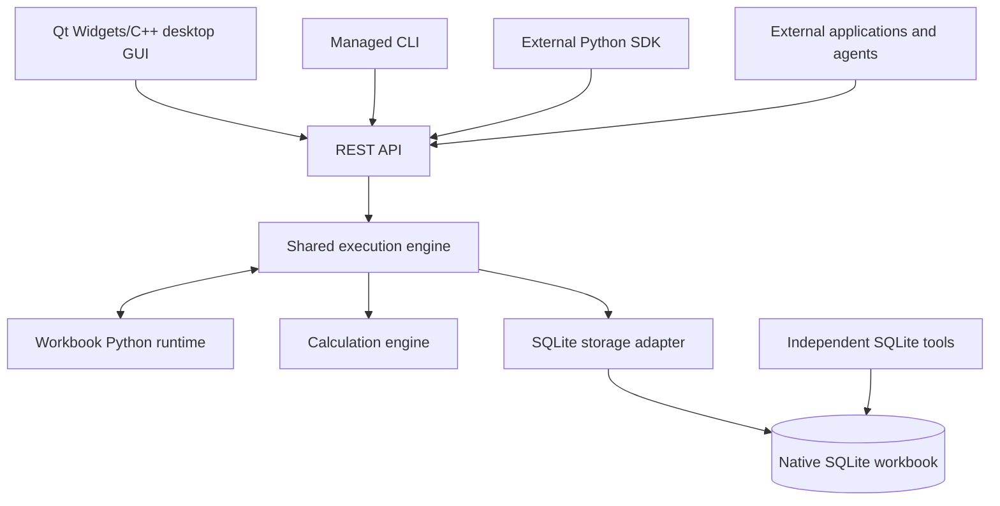

# Architecture

Status: agreed access boundary; proposed component and execution design.

## Components

The diagram shows responsibility boundaries, not a selected process topology.
The Python runtime may run in a separate process, but remains coordinated by the
service and available without a desktop client.

| Component | Responsibility |
| --- | --- |
| Qt Widgets/C++ desktop GUI | Grid rendering, editing, navigation, formula entry, code tools, and job feedback |
| REST layer | Authentication, request validation, serialization, API versions, and job resources |
| Execution engine | Operation planning, transaction ownership, Python events, changes, and errors |
| Python runtime | Execute workbook modules, handlers, macros, and custom functions |
| Calculation engine | Formula parsing, references, dependencies, invalidation, and evaluation |
| Storage adapter | Connections, queries, changes, migrations, and consistent snapshots |
| Client SDK and CLI | Express engine operations through REST and present their results |

Clients must not duplicate business behavior or write workbook data directly as
an invisible optimization. Embedded Python uses an engine context that preserves
the active transaction; it need not make HTTP requests back to its own service.

## Managed and direct access

| Concern | Managed access | Direct SQLite access |
| --- | --- | --- |
| Python handlers | Applicable handlers execute in the service | Do not execute |
| Calculations | Engine evaluates or explicitly marks pending/stale | Cached values may become stale |
| Database constraints | Engine configures and uses SQLite constraints | Governed by schema and external connection settings |
| Python validation | Applies through registered handlers | Does not apply |
| Application history | Can record engine operations and their context | No promise of application history or actor attribution |
| Data refresh | Engine tracks its managed changes | Requires reload/invalidation when detected or reopened |

SQLite-native constraints and Python rules are different layers. In particular,
foreign-key enforcement must be enabled on each engine connection; external
connections choose their own settings. See [SQLite foreign-key
support](https://www.sqlite.org/foreignkeys.html).

Direct access is intentional. Document the data schema and reserved metadata,
but do not require Python callbacks merely to open or edit ordinary stored data.
External modification of internal metadata or schema can make the workbook
incompatible; the engine must report that condition rather than guessing a repair.

## Managed operation lifecycle

The proposed lifecycle is:

1. Authenticate, authorize, and validate the request and execution policy.
2. Resolve object identities, operation scope, and any expected versions.
3. Start an engine-owned transaction and run applicable operation hooks.
4. Apply changes and collect actual affected records/cells.
5. Run transactional change handlers; apply their additional edits through the
   same context, capturing subsequent changes until processing settles.
6. Validate the final state, update dependencies, and calculate affected values
   or durably mark their calculation state as pending.
7. Persist managed history, revision information, and after-commit work if those
   facilities are enabled; commit together with the data.
8. Notify clients and dispatch after-commit handlers.

Step 5 must have a deterministic order and finite execution limits. Any failure
before commit rolls back the operation's database changes. A post-commit failure
is reported separately and cannot turn a committed write into a rollback.

The [Python runtime design](python-runtime.md) defines the proposed event model.
The same lifecycle applies to managed SQL writes. Bulk operations may be
background jobs, but job execution does not weaken their declared transaction
boundaries. Chunked commits must be explicit and report partial completion.

## SQL integration

Full SQL support over user data is a product goal. Managed SQL must participate
in the execution engine, including Python change handlers and invalidation.
Passing SQL to a connection and tracking only the statement text is insufficient.

Before implementing write support, prove how to capture actual changes, including
old/new values, trigger effects, foreign-key cascades, upserts, and replacements.
Possible mechanisms include connection-local capture triggers or a SQLite
binding exposing pre-update hooks. Capture callbacks should collect information;
Python business handlers run at engine-controlled points outside low-level
callbacks. The mechanism and supported SQL surface remain open.

SQLite's [pre-update interface](https://www.sqlite.org/c3ref/preupdate_blobwrite.html)
requires a build option and excludes virtual and system tables. Its ordinary
[update hook](https://www.sqlite.org/c3ref/update_hook.html) has further omissions.
Neither can be assumed to solve all SQL change capture without verification.

Schema changes require metadata and reference updates as well as row changes.
Transaction control, connection pragmas, attached databases, extensions, and
engine-owned objects need explicit policies. Reject unsupported operations
clearly; never silently execute a managed write without its applicable hooks.

## Concurrency and scale

Proposed defaults are one service coordinating managed writers per open
workbook, short write transactions, and bounded concurrent reads. Other SQLite
tools may still open their own connections. SQLite allows only one writer at a
time; WAL permits readers alongside a writer. See [SQLite
isolation](https://www.sqlite.org/isolation.html).

Use version checks for stale edits, busy timeouts with bounded retry, bounded
grid reads, indexed navigation, and cancellable jobs. Pagination must define
stable ordering and snapshot behavior. Managed revision numbers alone cannot
prove that an independent SQLite writer has not changed the data.

WAL is a candidate, not a final storage decision. Its sidecar files, checkpoint
policy, and same-host restriction matter for portable workbooks. Remote clients
should access the service on the database host through REST; sharing a live
WAL database over a network filesystem is not the remote-access architecture.
See [SQLite WAL documentation](https://www.sqlite.org/wal.html).

## External edits and reopen

While a workbook is open, a long-lived connection can compare
[`PRAGMA data_version`](https://www.sqlite.org/pragma.html#pragma_data_version)
values from that same connection to detect commits by other connections. This
does not identify changed rows, distinguish another engine connection from an
independent tool by itself, or provide a persistent revision across reopenings.

On an unexplained external change, invalidate conservatively, refresh affected
client state, and recheck outstanding edits before committing them. Detailed
conflict detection and whether live external schema changes are supported need
an implementation experiment.

On reopen, validate the format/schema and treat persisted derived state as
unverified until it is rebuilt or checked by a separately proven mechanism.
Ordinary configured open handlers can run according to execution policy.
Do not synthesize historical edit events, replay skipped macros, or claim a
complete change history for direct edits. Formula evaluation, including a Python
custom function, is distinct from replaying an edit handler.

## Durability and recovery

Use SQLite transactions for database atomicity. Establish and test durability
settings, interrupted-operation recovery, and consistent backup/restore behavior
before a production release. A live workbook snapshot should use a supported
database backup mechanism rather than copying only the main file while writes
are active. See the [SQLite backup API](https://www.sqlite.org/backup.html).

Durable job records and after-commit work, if implemented, must recover without
claiming exactly-once external effects. Operation IDs and idempotent consumers
are part of that design. Undo is a new managed change, not a database rollback
after commit; its handler semantics and limits remain open.
